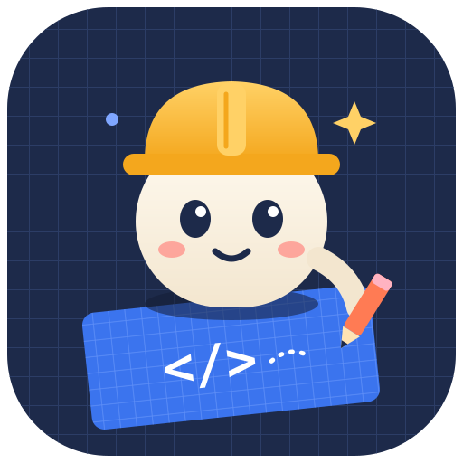
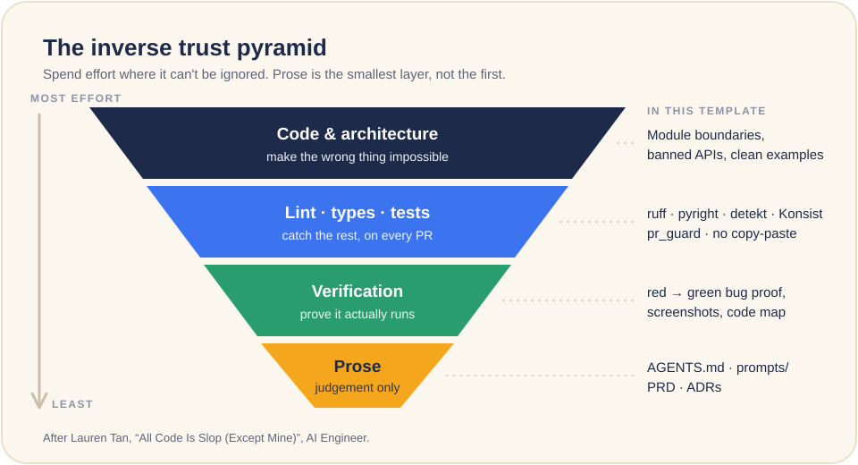
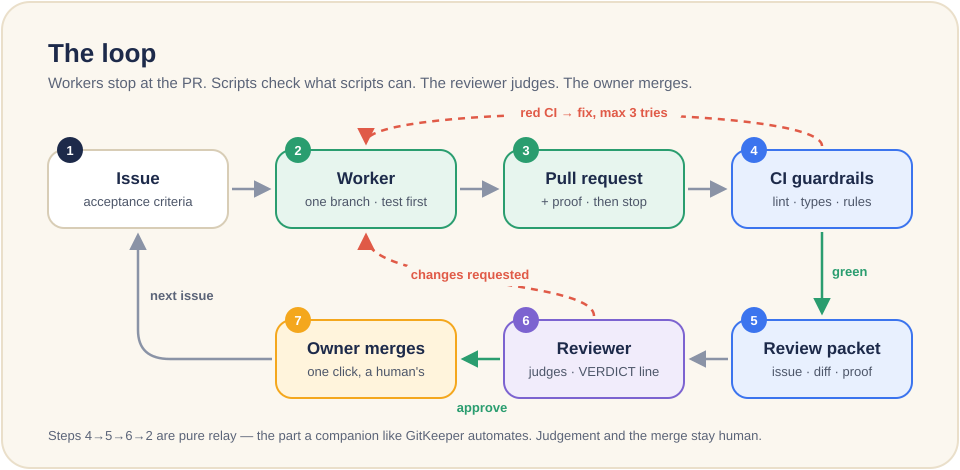
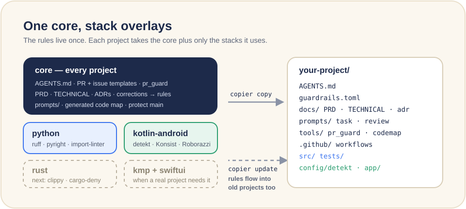
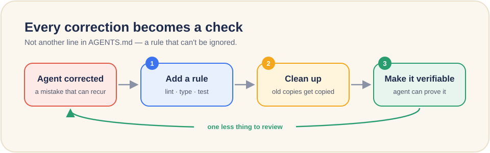

<p align="center">
  
</p>

<h1 align="center">Vibe-code-Architect</h1>

<p align="center">
  <b>Guardrails for building software with AI agents.</b><br>
  A project template where the rules are enforced by CI, not by hope.
</p>

<p align="center">
  <a href="LICENSE"></a>
  
  
  
</p>

---

## Why this exists

I build almost everything with AI now. One strong model (Claude) is my architect and
reviewer; cheaper agents (OpenCode, Copilot, Codex) are the workers. I'm on a $20 plan,
so the strong model's attention is the scarcest thing I have.

For a while my answer to "how do I keep agents in line?" was **more writing**: a product
doc, a technical doc, a tracker, long rule files, detailed plans. On one project that
reached 56,000 words of markdown around 12,000 lines of code, and nothing ran end to end
yet. Every review correction became another paragraph, and the next agent over-applied it.

Then I watched Lauren Tan's talk
[*All Code Is Slop (Except Mine)*](https://www.youtube.com/watch?v=O_zcc6Xl12g), and one
idea reorganised how I work: **put your effort where it can't be ignored.** Make the wrong
thing impossible in code. Catch the rest with lint, types and tests. Make agents prove the
change works. Keep prose for the few things that genuinely need judgement.

This repo is what I now start every project with. It combines:

- **Andrej Karpathy's four rules** for AI coding: think before coding, simplicity first,
  surgical changes, goal-driven execution;
- **TDD**, which I've always used: the first commit is the failing test;
- my **architect / worker / owner** workflow: one issue, one branch, one PR, then stop;
- Lauren's **trust pyramid**: deterministic checks first, prose last.

It's opinionated because it's mine. Fork it and make it yours.

## The idea in one picture

<p align="center"></p>

Most AI-coding setups are a pyramid standing on its point: a huge `AGENTS.md` doing
everything, and very little enforced. This template flips it. Every rule that a script can
check is a script. `AGENTS.md` stays short because it only holds what needs judgement.

## Principles

1. **Deterministic first.** Never pay a model, or a human, to check what a script can
   verify in five seconds: branch names, PR size, tests present, issue linked, lint,
   types, module boundaries, copy-paste, banned APIs.
2. **Prose last.** Rules written only in a document get broken. Agents also over-apply
   prose: one small correction becomes a law. So prose holds judgement, nothing else.
3. **Proof, not diffs.** A diff shows what changed, not that it works. Every PR carries
   verification. Wherever possible, CI produces that proof for the exact commit: a bug-fix
   test that fails on the old code and passes on the new, screenshot tests, coverage of
   the changed lines.
4. **Every correction becomes a check.** Correct an agent once. Then add the rule, clean up
   the old copies so nobody copies them again, and give agents a way to verify.
5. **Code is the next agent's prompt.** Agents copy the patterns they find. Workarounds,
   comments justifying shortcuts and duplicated logic spread. Keep the garden clean.
6. **Humans judge and merge; status is derived.** The reviewer judges, the owner merges.
   Nobody writes status updates: GitHub Issues are the tracker, and the code map is
   generated from the code.
7. **Bounded autonomy.** Workers stop at the PR. Branch protection, not a polite prompt,
   is what stops them merging.

## The loop

<p align="center"></p>

| Role | Who | Does | Never does |
| --- | --- | --- | --- |
| **Owner** | You | Writes the PRD, decides, merges | Hand-writes status or tracker updates |
| **Reviewer** | A strong model (I use Claude), through the owner | Judges the PR against the issue, the rules and the proof; ends with a `VERDICT:` line | Writes code in the PR, merges |
| **Worker** | Any coding agent | One issue → one branch → tests first → one PR with proof → **stop** | Merges, pushes to `main`, edits guardrails |

Steps 4 → 5 → 6 → 2 are pure relay: copying the review packet to the reviewer and the
change request back to the worker. That's the part worth automating, which is where
GitKeeper comes in. The template works fine without it.

## The companion: GitKeeper

This template and [GitKeeper](https://github.com/SumukhaK/GitKeeper) come from the same
idea. The template sets the **rules**. GitKeeper, a small Windows desktop companion (a fox
that lives on your screen), runs the **relay** so the owner only reads and decides:

| Loop step | What GitKeeper does | What stays human |
| --- | --- | --- |
| PR raised, CI green | Notices it and tells you a review is waiting | — |
| Review | One click copies the review packet (issue, diff, CI, proof, `prompts/review.md`) | You paste it to the reviewer and judge the answer |
| Verdict | Reads the `VERDICT:` line you paste back; posts the review on the PR | — |
| Changes requested | Prepares `prompts/changes.md` for the worker, same branch; stops after 3 rounds | — |
| CI red | Hands the failure to the worker to fix, max 3 tries | — |
| Approved | Shows "ready to merge" | **You click Merge** |
| After merge | Shows the next open issue with its task prompt, then sleeps | — |

It never calls a model by itself and never merges, so the reviewer's usage stays under your
control. Everything it relies on is the template's contract: the PR template, the issue
forms, the prompts and the fixed verdict format. Any repo generated from this template works
with it.

> **Status:** in development, and private for now (the link works once it's public).
> I re-scoped it after building too much of it the hard way. That lesson is a big part of
> why this template exists.

## What you get

<p align="center"></p>

### Core (every project)

| File | What it does |
| --- | --- |
| `AGENTS.md` | The short rulebook: roles, Karpathy's four rules, the loop, proof, "stop after the PR" |
| `guardrails.toml` | Limits and paths for the PR guard: branch pattern, size limits, source/test globs, protected files |
| `tools/pr_guard.py` | CI check: branch name, PR size, tests with source changes, `Closes #N`, a non-empty **Verification** section, and **guardrail files only change on `upkeep/` branches** |
| `tools/codemap.py` | Generates `docs/CODEMAP.md`, the project's memory map (files and top-level symbols). CI fails if it's stale, so it never drifts |
| `.jscpd.json` + CI | Fails on copy-pasted blocks, because duplicates become patterns |
| `tools/protect_main.sh` | Protects `main`: PRs only, required checks, no force-push. This is what really stops workers merging |
| `.github/` | PR template (issue + verification), task and bug issue forms, guardrail workflow |
| `prompts/` | `task.md` for workers, `review.md` for the reviewer (fixed `VERDICT:` format), `changes.md` for change requests |
| `docs/PRD.md` | One-page, non-technical product requirements |
| `docs/TECHNICAL.md` + `docs/adr/` | The current technical picture, plus one short file per decision and why |
| `docs/corrections.md` | Every repeated mistake and the rule that now catches it |

### Overlays

| Overlay | Adds |
| --- | --- |
| **python** | `pyproject.toml` with ruff (incl. banned APIs, complexity, no commented-out code), strict pyright, import-linter boundaries (`domain` never imports `adapters`), vulture dead-code check, pytest with coverage and **diff coverage**, and `tools/red_green.py`: on `bugfix/` branches, CI proves the new test **fails on the old code** |
| **kotlin-android** | detekt config with banned APIs (`Thread.sleep`, `postDelayed`, `GlobalScope`…) whose messages tell the agent what to do instead, a Konsist architecture test (domain / data / ui layers), Roborazzi screenshot-test wiring, and CI that attaches screenshots and reports to every run as proof |

## Quick start

You need [Copier](https://copier.readthedocs.io) (Python 3.12+):

```bash
pipx install copier      # or: pip install copier
copier copy --trust gh:SumukhaK/Vibe-code-Architect my-project
```

Copier asks for a name, a one-line description, your GitHub username and the **stacks**.
`--trust` lets it run the one post-generation step, writing the initial code map.

Then:

```bash
cd my-project
git init -b main && git add -A && git commit -m "chore: start from Vibe-code-Architect"
gh repo create --private --source . --push     # or create it on github.com and push
bash tools/protect_main.sh                       # PRs only, checks required
```

### By tech stack

<details open>
<summary><b>Python backend or library</b></summary>

```bash
copier copy --trust gh:SumukhaK/Vibe-code-Architect my-api     # pick: python
cd my-api
python -m venv .venv && source .venv/bin/activate              # Windows: .venv\Scripts\activate
pip install -e ".[dev]"
ruff check . && pyright && lint-imports && pytest              # all green out of the box
```

Your code goes in `src/<package>/domain` (pure logic) and `src/<package>/adapters`
(HTTP, database, files). import-linter fails the build if domain imports adapters. Add
FastAPI or anything else you like; each new dependency gets an ADR.
</details>

<details>
<summary><b>Native Android (Kotlin + Jetpack Compose)</b></summary>

1. Create the app in Android Studio (Empty Compose Activity).
2. Run Copier **into the same folder** and pick `kotlin-android`:
   ```bash
   copier copy --trust gh:SumukhaK/Vibe-code-Architect ./MyApp
   ```
3. Wire detekt, Konsist and Roborazzi into Gradle. The exact snippets are in the
   generated `docs/android-setup.md`.
4. `./gradlew testDebugUnitTest detekt lint verifyRoborazziDebug`

Keep packages `domain`, `data` and `ui`; the architecture test enforces the direction.
</details>

<details>
<summary><b>Python backend + Android app in one repo</b></summary>

Pick both stacks. Guardrails, the code map and branch protection cover both; each
stack gets its own CI job.
</details>

<details>
<summary><b>Rust backend, or a Tauri desktop app</b> (overlay planned)</summary>

Until the Rust overlay exists (it will be extracted from a real project, not guessed),
generate with any stack, delete that stack's files, and set the globs in
`guardrails.toml` to `src/**` / `tests/**`. Then add, in an `upkeep/` PR:

- `cargo clippy -- -D warnings`, with banned APIs in `clippy.toml` via `disallowed-methods`
- `cargo fmt --check`, `cargo test`, `cargo deny check`
- for Tauri: the same frontend checks you'd use for any web UI
</details>

<details>
<summary><b>Kotlin Multiplatform + SwiftUI</b> (overlay planned)</summary>

Use the `kotlin-android` overlay for the shared and Android modules (detekt + Konsist
apply to `shared/` too: extend the `source` paths). For the iOS app, add SwiftLint with
custom rules for your banned patterns, and snapshot tests as UI proof.
</details>

<details>
<summary><b>Anything else</b></summary>

Pick any stack, remove its overlay files, and set three things in `guardrails.toml`:
`source_globs`, `test_globs` and `[codemap] roots`. The core (the rules, PR guard, proof,
prompts and docs) is language-agnostic.
</details>

## Working day to day

1. **Write `docs/PRD.md`.** One page, plain words, no technology. If it doesn't fit on a
   page, the product isn't clear yet.
2. **Write `docs/TECHNICAL.md`** with the strong model. Record each real decision as an ADR.
3. **Turn the PRD into issues** using the Task form: goal, acceptance criteria, files likely
   to change, expected proof. Issues *are* the tracker.
4. **Give a worker `prompts/task.md`** filled in with one issue. It branches, writes the
   failing test, implements, opens a PR with proof, and stops.
5. **CI runs the guardrails.** If red, the worker fixes it (I cap this at three tries).
6. **Give the reviewer `prompts/review.md`** with the review packet (issue, PR, diff, CI
   results, proof). It ends with `VERDICT: APPROVE` or `VERDICT: CHANGES_REQUESTED` plus a
   ready-to-paste worker prompt.
7. **Changes?** Give the worker `prompts/changes.md`. Same branch, same PR. Back to step 5.
8. **Approved?** You merge. `Closes #N` closes the issue. Take the next one.

<p align="center"></p>

**When the reviewer corrects something that could happen again**, don't add a sentence to
`AGENTS.md`. Open an `upkeep/` issue: add the rule (a ruff banned API, a detekt
`ForbiddenMethodCall`, an import contract, a Konsist test), clean up existing copies, and
log it in `docs/corrections.md`. Each one leaves one less thing to review, forever.

## What counts as proof

| Change | Proof | Produced by |
| --- | --- | --- |
| Bug fix | A test that fails on the old code and passes on the new | CI (`red_green.py` on `bugfix/` branches) |
| Logic / API | Tests + coverage of the changed lines | CI (`diff-cover`) |
| Android UI | Screenshot tests rendered on the JVM | CI (Roborazzi), attached to the run |
| Multi-step behaviour | A small state diagram of what the user sees | Worker; the reviewer checks it against intent |

Proof that a worker pastes is a claim. Proof that CI produces for the exact commit is evidence.

## Keeping projects up to date

When a rule proves itself in one project, promote it into the template's overlay. Then,
in every project:

```bash
copier update --trust
```

Copier merges template changes into each project, so improvements spread instead of
living in one repo.

## This repository

```
copier.yml        questions and stack choices
template/         what gets generated (core files + conditional overlays)
tests/            tests for the guard tools and for generated projects
assets/           logo and diagrams
```

This repo practises what it preaches: the tools were written test-first, CI generates a
project for every stack combination, and a generated Python project must pass its own
strict checks (ruff, pyright, import-linter, vulture, pytest) on every change. Run the tests yourself:

```bash
pip install copier pytest && pytest
```

## Known gaps

Honesty over polish. What isn't proven yet:

- **The Kotlin overlay hasn't been run in a real Gradle build yet.** The detekt config,
  Konsist test and Roborazzi wiring follow those tools' documented APIs, but they'll be
  validated when I apply them to my Android app. Library versions in
  `docs/android-setup.md` will age; bump them in `upkeep/` PRs.
- **Red-green bug proof is Python-only** for now.
- **The code map is regex-based** (top-level symbols, Python/Kotlin/Rust/Swift). It's a
  map, not a full dependency graph.
- **`protect_main.sh`** targets personal repos. Organisations may need different settings.
- Size limits (400 lines, 12 files) are my defaults. Tune them in `guardrails.toml`, on
  an `upkeep/` branch.

## Make it yours

Fork it, change the rules, add your overlays. If you're building one, the bar I use is
simple: **extract it from a real project, don't invent it.** A rule nobody has needed yet
is a guess.

## Credits

- **Andrej Karpathy** for the four rules of AI-assisted coding.
- **Lauren Tan** for [*All Code Is Slop (Except Mine)*](https://www.youtube.com/watch?v=O_zcc6Xl12g)
  (AI Engineer): the inverse trust pyramid, codebase-as-garden, corrections-to-lint-rules,
  and review by verification artifacts.
- [Copier](https://copier.readthedocs.io), [ruff](https://docs.astral.sh/ruff/),
  [pyright](https://github.com/microsoft/pyright),
  [import-linter](https://import-linter.readthedocs.io),
  [detekt](https://detekt.dev), [Konsist](https://docs.konsist.lemonappdev.com),
  [Roborazzi](https://github.com/takahirom/roborazzi), [jscpd](https://github.com/kucherenko/jscpd).

## Licence

[MIT](LICENSE). Built by [Sumukha Aithal K](https://github.com/SumukhaK).
